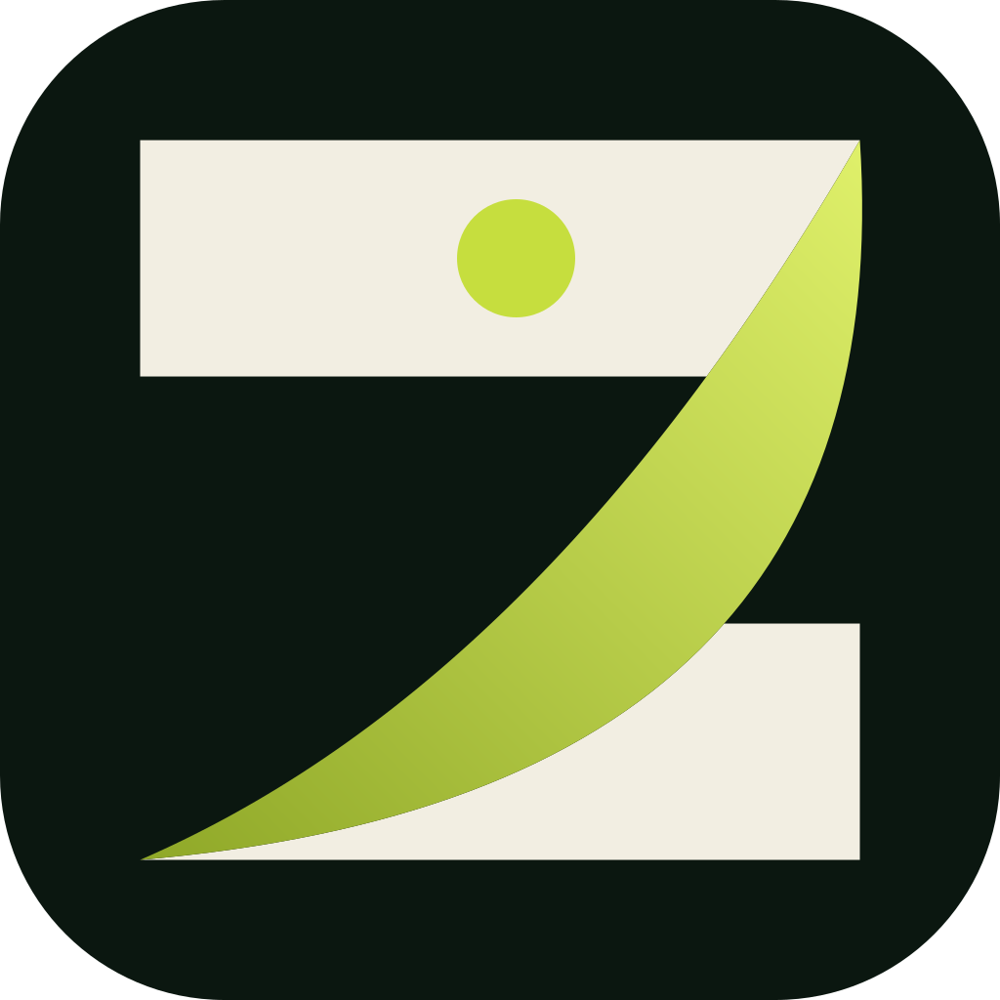
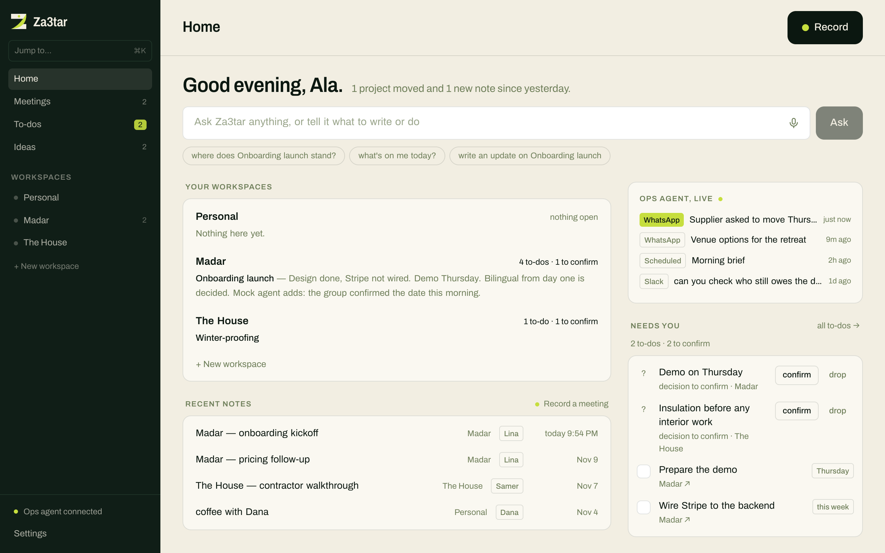
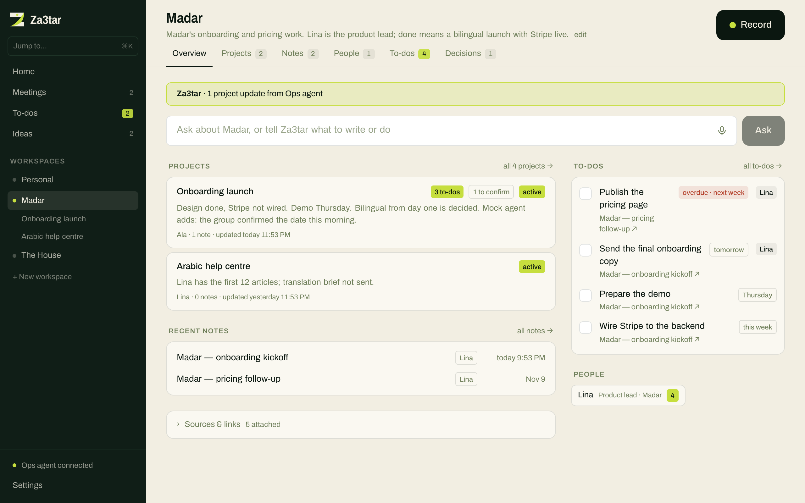
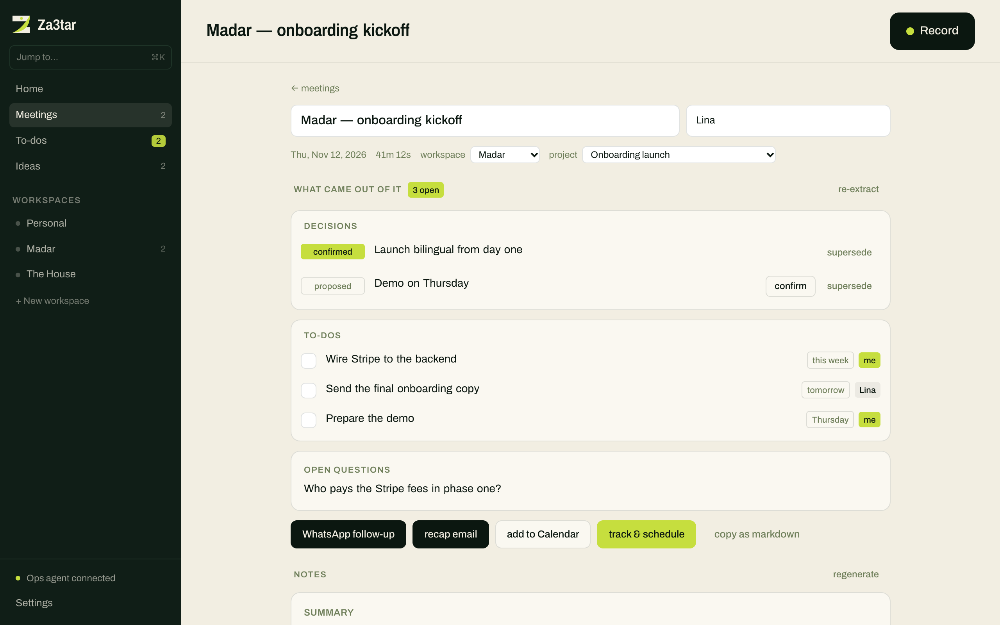

<div align="center">



# Za3tar

**One place on your Mac for the work that is moving.**

Record a meeting, and its decisions and to-dos land in the right project.
Ask where anything stands. Hand the rest to your own AI assistant.
Arabic, English, or both in the same sentence.

[](https://github.com/arhadd/za3tar/actions/workflows/release-check.yml)
[](LICENSE)
[](LICENSES/README.md)
[](docs/INSTALL.md)
[](#bring-your-own-keys)

[Try it in two minutes](#try-it-in-two-minutes) ·
[Keys](#bring-your-own-keys) ·
[Assistants](#connect-your-own-assistant) ·
[Privacy](#privacy) ·
[Contribute](#contributing)

<br>



</div>

<br>

## What it is

Za3tar is an open-source Mac app that keeps a small team's work in one
picture: workspaces, the projects inside them, the people involved, what was
decided, and what is still open. Meetings are the main way things get in. You
press Record, talk, and the outcome is filed where it belongs.

It runs on your Mac, on your own provider keys. No account is needed and
there is no telemetry.

> **Early build.** Za3tar works today, but there is no signed download yet.
> For now you run it from source.

## What you can do with it

### Keep each workspace in view

A workspace holds its projects, notes, people, to-dos and decisions. Each
project carries one line on where it stands, so you can read the state of a
whole company in a minute.



### Record a meeting, get what came out of it

No bot joins the call. Za3tar records your mic and the call audio on your
Mac, transcribes it, and pulls out decisions, to-dos with owners and dates,
and open questions. It does not invent commitments nobody made.

From there: draft the WhatsApp follow-up or recap email the way the meeting
was spoken, add dated to-dos to Calendar, or send the whole thing to your
assistant.



### And the rest

**Ask.** Type or say what you need: "where does the launch stand?", "what's
on me today?", "write an update on pricing". Za3tar answers from your own
records.

**Talk.** Speak with Za3tar out loud when typing is slower than saying it
(optional, needs an OpenAI key).

**Follow through.** One list of every open to-do across all workspaces: what
is on you, what you are waiting on, what is overdue, and a one-tap nudge to
the person who owes it.

**Arabic and English as people speak them.** Arabic stays in Arabic script.
English names and technical terms stay as they were said. You choose what
Za3tar writes in; messages to other people are written the way they spoke.

## Try it in two minutes

No keys, no Mac permissions, any OS. This runs the whole interface in your
browser on a made-up company:

```bash
git clone https://github.com/arhadd/za3tar.git
cd za3tar
npm install
npm run dev
```

Open http://localhost:1420 and look around. Add `?fresh=1` to see first-run
setup. Nothing is saved.

### The real app

You need macOS 14.4 or later, Node.js, Rust via [rustup](https://rustup.rs/)
and Xcode Command Line Tools.

```bash
npm install
npm run app
```

Add your keys in **Settings**, record a short test, and allow microphone and
System Audio Recording when macOS asks. Full steps and troubleshooting are in
[`docs/INSTALL.md`](docs/INSTALL.md).

## Bring your own keys

Za3tar has no built-in AI account. You add keys from the providers you
choose, and each call goes from your Mac straight to that provider, billed to
you. Keys are stored in a file only your user can read and never reach the
interface layer.

| key | what it turns on | needed? |
|---|---|---|
| [ElevenLabs](https://elevenlabs.io/app/settings/api-keys) | transcription (Scribe v2) | yes, to transcribe |
| [Anthropic](https://console.anthropic.com/settings/keys) | notes, decisions, to-dos, drafts, the ask box | yes, for notes |
| [OpenAI](https://platform.openai.com/api-keys) | Talk: speaking with Za3tar out loud | optional |
| [TypeSafe](https://console.typesafe.ai/keys) | the ask box reads what you type as you type | optional |

With no keys at all the app still opens, records, and keeps your workspaces,
projects and people. Home tells you what is missing.

Two optional settings for your own Anthropic key: a different Claude model
for notes (`ZA3TAR_NOTES_MODEL`, also in Settings), and a different endpoint
that speaks the Anthropic Messages API, such as a company gateway
(`ANTHROPIC_BASE_URL`).

**For a team without keys.** Run the small server in
[`proxy/`](proxy/README.md) with the team's provider keys and hand out invite
codes. People choose "Sign in with Za3tar" and need no keys of their own.
Za3tar runs one for invited testers. It is the same app either way.

## Connect your own assistant

Za3tar ships no agent. If you already run one that holds your calendar, your
chats and your memory, connect it in Settings and Za3tar can pass it work:
schedule the dated to-dos, deliver a follow-up, check which open items are
already done, and show what it is doing elsewhere as it happens.

```text
   meeting, note or ask
           │
        Za3tar            your Mac: records, transcribes, files, drafts
           │
   versioned envelopes    docs/AGENT-PROTOCOL.md (Apache-2.0)
           │
    your assistant        any command: ACP on stdio, or one message in, one reply out
```

- **The protocol is open.** [`docs/AGENT-PROTOCOL.md`](docs/AGENT-PROTOCOL.md)
  is Apache-2.0, so any agent, open or commercial, can implement it without
  taking on the app's licence.
- **A worked example.** [`docs/adapters/hermes.md`](docs/adapters/hermes.md)
  shows the full set-up for Hermes; [`kit/`](kit/README.md) gathers what an
  assistant's server needs.
- **Nothing acts without you.** The assistant answers; you apply. With none
  connected, those controls stay hidden and everything else works.

## Privacy

Audio, transcripts, notes, contacts and to-dos are stored on your Mac. There
is no telemetry and no cloud sync. Processing is not offline: each provider
you configure receives only what its step needs.

| who | receives | when |
|---|---|---|
| ElevenLabs | meeting audio | when a recording is transcribed |
| Anthropic | transcript text and the context of the ask | notes, to-dos, drafts, answers |
| OpenAI | microphone audio | only during a Talk session you start |
| TypeSafe | the text in the ask box | only if you added its key |
| your assistant | the meeting packet described in the protocol | only if you connected one |

The full data flow is in [`docs/PRIVACY.md`](docs/PRIVACY.md). Get the
consent you need before recording other people.

## Status

Working today:

- workspaces, projects, people, decisions, ideas and one to-do list across
  all of them
- recording without a bot: separate me / them tracks on calls, one
  echo-cancelled track with speaker separation in person
- Arabic and English transcription, notes, decisions, to-dos with owners and
  dates
- the ask box, Talk, WhatsApp and email drafts, Calendar export
- assistants over an open protocol, with schedule and status sync

Still being hardened:

- a signed, notarized download (today you build from source)
- first run and permissions on fresh Macs
- more dialects, more devices, longer meetings
- more providers: transcription is ElevenLabs only and notes are Claude only

## Built with

Tauri v2 · Rust · React · TypeScript · Tailwind CSS · Swift (Core Audio
process taps for capture) · plain local files for storage

## Contributing

Contributions are welcome, and you can work on the whole interface with no
keys and no Mac. The most useful ones right now:

- **Dialects.** Notes or transcripts that come out wrong for yours.
- **A local transcription engine**, so one step needs no key at all.
- **More providers** for notes.
- **Assistant bridges**: the protocol implemented for other agent stacks.
- **Bugs with a repro**, especially in capture.

[`CONTRIBUTING.md`](CONTRIBUTING.md) has the set-up, a map of the code and the
ground rules. Security reports go through [`SECURITY.md`](SECURITY.md).
Never attach real meeting audio or transcripts to a public issue.

## Licence

- **The app and capture code:** [GNU AGPL-3.0-only](LICENSE)
- **The assistant protocol:** [Apache-2.0](LICENSES/Apache-2.0.txt)
- **The website in `site/` and the brand marks:** not licensed for reuse

The exact boundary is in [`LICENSES/README.md`](LICENSES/README.md).

---

<div align="center">

Made by [Za3tar](https://za3tar.ai) · [Demo script](DEMO.md) · [Install](docs/INSTALL.md) · [Release checklist](docs/RELEASE.md)

</div>
